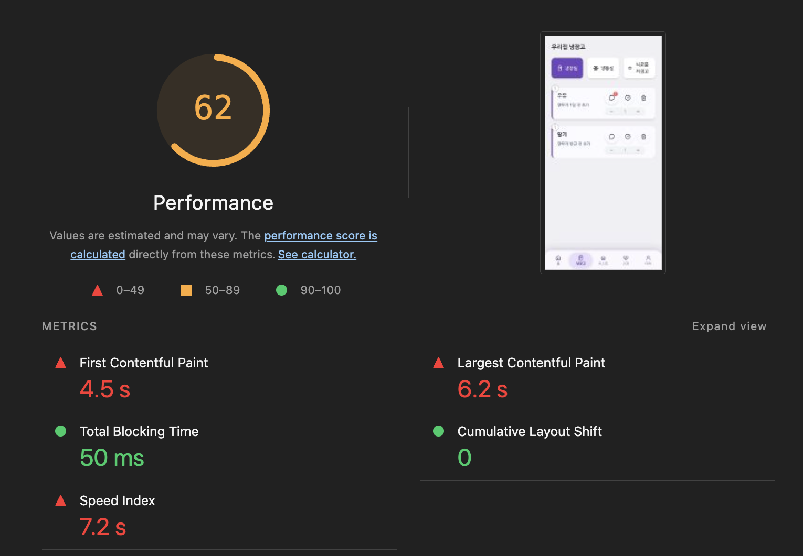
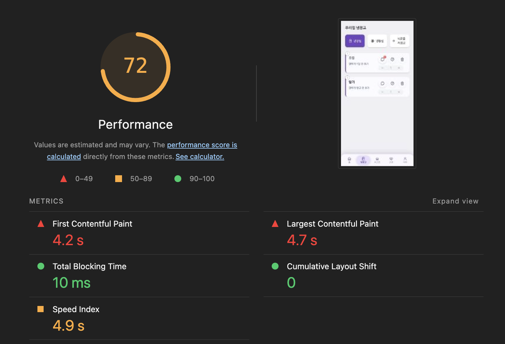

# 🥦 우리집 냉장고 (Greenbox)

<div align="center">


**집에 있는 식재료를 한눈에 관리해 식품 낭비를 줄이는 PWA**

[데모 보기](https://greenbox-seven.vercel.app)

</div>

## 1. 소개

**우리집 냉장고(Greenbox)** 는 냉장고 속 식재료와 유통기한을 관리해 식품 낭비를 줄이는 것을 목표로 하는 PWA 기반 웹 서비스입니다. 모바일 환경을 우선으로 설계했고, 홈 화면 설치 등 네이티브 앱에 가까운 경험을 제공합니다.

> ⚠️ 개인 학습용 사이드 프로젝트입니다. 냉장고 품목과 댓글은 Postgres에 저장하고, 장바구니와 구매 통계는 브라우저 로컬 저장소(localStorage, IndexedDB)에, 활동 피드와 상품 목록은 목업으로 동작합니다. 아래 [구현한 기능](#-구현한-기능)과 [앞으로의 과제](#-앞으로의-과제)에서 현재 구현 범위를 정확히 구분해 적었습니다.

## 2. 성능 최적화: 약한 네트워크를 위한 설계

> 이 앱은 **마트에서 장을 보며** 사용합니다. 즉 약하고 불안정한 네트워크가 기본 사용 환경입니다. 그런데 정작 가장 느린 환경에서 가장 느렸습니다.

### 문제 - "가장 느린 네트워크에서 쓸 앱인데, 가장 무거운 초기 로딩"

Lighthouse(모바일 / Slow 4G) 베이스라인에서 병목은 전부 **초기 로딩**이었습니다. TBT, CLS는 양호했고, 느린 건 첫 화면이 뜨는 속도(LCP 6.2s)였습니다.

### 진단 - 코드 레벨 원인

번들을 분석하니, 차트 라이브러리 **recharts(약 343KB)가 분석 탭 한 곳에서만 쓰이는데도 모든 사용자의 첫 로드에 포함**되고 있었습니다. 정작 대부분의 사용자는 냉장고 탭만 봅니다.

### 개선 - `next/dynamic` 코드 스플리팅

해당 탭을 **실제로 열 때만** recharts가 로드되도록 분리했습니다. 분리된 청크도 Service Worker가 precache하므로 **오프라인 동작은 그대로 유지**됩니다.

### 결과 (Lighthouse, 모바일 / Slow 4G 동일 조건)

| 지표 | Before | After | 변화 |
|---|---|---|---|
| `/` First Load JS | 240 kB | **117 kB** | **−51%** |
| Performance | 62 | **72** | +10 |
| Largest Contentful Paint | 6.2s | **4.7s** | −24% |
| Speed Index | 7.2s | **4.9s** | −32% |
| Total Blocking Time | 50ms | **10ms** | −80% |

<div align="center">

<!-- 📸 여기에 Lighthouse before/after 캡처를 넣으세요 (나란히 2장) -->
<!-- 업로드 후 아래 두 줄의 src를 GitHub이 생성한 이미지 URL로 교체 -->

<table>
<tr>
<td align="center"><b>Before</b><br/>Performance 62</td>
<td align="center"><b>After</b><br/>Performance 72</td>
</tr>
<tr>
<td></td>
<td></td>
</tr>
</table>

</div>

> **다음 단계:** 번들을 걷어내자 가려져 있던 다음 병목(render-blocking ~1.8s)이 드러났습니다. *첫 방문은 초기 로딩 최적화로, 재방문은 Service Worker 캐싱으로* - 약한 네트워크를 두 겹으로 방어하는 방향으로 이어가고 있습니다.

## 3. 서버 상태 설계: React Query + zod

> 냉장고 품목이 화면 메모리 목업에만 있어 새로고침하면 사라졌고, 서버 응답도 `as` 단언으로만 믿고 있었습니다. 품목을 Postgres API로 옮기면서 서버 상태 레이어를 설계했습니다.

### 설계 결정

| 결정 | 이유 |
|---|---|
| 같은 zod 스키마를 서버 요청 검증과 클라이언트 응답 검증에 사용 | API 계약을 한곳에 두고, 타입이 사라지는 런타임에서 불일치를 네트워크 경계에서 잡기 위해 |
| `apiFetch(url, schema)`로 호출 창구 통일 | 재시도할 수 있는 실패(5xx, 네트워크)와 다시 보내도 같은 실패(4xx, 응답 형식 불일치)를 구분하기 위해 |
| 계층형 쿼리 키 `itemKeys` | 무효화 범위를 키 하나로 표현하고, 키 오타를 막기 위해 |
| 수량 변경과 소진에 낙관적 업데이트 | 약한 네트워크(마트)에서도 바로 반응해야 하고, 결과를 미리 알 수 있는 변경이라서 |
| 등록은 성공 후 무효화, 댓글은 응답을 캐시에 반영 | 서버가 id를 만드는 변경이라 결과를 미리 알 수 없어서 |
| 첫 화면은 정적으로 유지하고 클라이언트에서 조회 | 로그인 뒤 사용자별 데이터이고 검색 노출이 필요 없어서 |

### 낙관적 업데이트에서 막은 경쟁 상태

1. **진행 중인 조회가 낙관적 값을 덮어씀** → `onMutate`에서 `cancelQueries`
2. **실패 롤백이 다른 품목의 변경까지 되돌림** → 목록 스냅샷이 아니라 실패한 품목만 복원
3. **먼저 끝난 요청의 재조회가 진행 중인 변경을 덮어씀** → 마지막 변경이 끝날 때만 무효화 (`isMutating`)
4. **같은 품목 연속 변경의 응답 순서 역전** → mutation `scope`로 품목별 직렬화

### 결과

| 지표 | Before | After |
|---|---|---|
| 새로고침 후 품목 유지 | 사라짐 | **유지** (Postgres) |
| `FridgeContext.tsx` | 320줄 | **152줄** |
| 응답 런타임 검증 | 없음 (`as` 단언) | **zod 스키마** |
| 단위 테스트 | 0개 | **28개** (Vitest) |

같은 개발 환경(StrictMode)의 첫 화면에서 직접 `fetch`하는 `/api/me`는 2회, React Query를 쓰는 `/api/items`는 1회 요청합니다. 운영 빌드에서는 StrictMode의 이중 실행이 없어 직접 `fetch`도 1회이므로, 이 수치는 운영 성능 개선이 아니라 중복 제거 동작의 확인입니다.

### 현재 범위와 확장

- 가족 기능 전이라 품목은 사용자(`user_id`) 기준으로 저장합니다. 가족 연결은 `family_id` 컬럼 추가와 조회 조건 변경으로 확장합니다.
- 장보기 완료 품목은 냉장실로 들어가고 유통기한은 비어 있습니다. 활동 피드는 아직 목업이라 새 활동이 쌓이지 않습니다.

## 4. 구현한 기능

현재 **실제로 동작하는** 기능입니다.

- 📱 **PWA / 오프라인 셸** - Service Worker가 앱 셸(JS, CSS, HTML)과 정적 이미지를 precache, 홈 화면 설치 지원
- 🧊 **냉장고 보드** - 품목 수량 변경, 소진, 댓글을 Postgres에 저장 (새로고침 후에도 유지). 장보기 완료 품목이 냉장실로 추가
- 🔐 **구글 로그인과 동의** - 필수 항목에 동의해야 가입되고, 동의 기록을 저장
- 🛒 **장바구니 & 즐겨찾기** - `localStorage` 기반 로컬 영속화 (새로고침 후에도 유지)
- 📊 **구매/소비 분석** - `IndexedDB` 기반으로 실제 구매 행동(장바구니 "구매완료")을 누적 저장하고 통계 시각화 (Recharts, 코드 스플리팅으로 지연 로딩)
- ⚡ **초기 로딩 최적화** - 코드 스플리팅으로 메인 First Load JS −51% (위 [성능 최적화](#2-성능-최적화-약한-네트워크를-위한-설계) 참조)

### 🟡 부분 구현

UI, 인터랙션은 동작하지만, 일부는 목업 데이터 또는 클라이언트 한정으로 동작합니다.

- 📰 **활동 피드** - 표시 데이터는 목업이며 새 활동이 쌓이지 않음
- 🗓 **유통기한 알림** - 설정 UI + **클라이언트 로컬 알림**(앱이 열려 있을 때 `setInterval`로 체크해 브라우저 알림 발송). 서버 푸시는 아래 과제 참조
- 📊 **분석 품목 풀** - 구매 카운트는 실제 누적되지만, 분석 화면에 나열되는 품목 리스트 자체는 목업

## 5. 기술 스택

### Frontend
- **Framework**: Next.js 15 (App Router), React 19, TypeScript
- **Styling**: Tailwind CSS
- **Server State**: TanStack Query (React Query), zod
- **UI State**: React `useState` + Context API
- **Test**: Vitest, Testing Library
- **Data Viz**: Recharts (지연 로딩)

### Backend
- **API**: Next.js Route Handlers
- **DB**: PostgreSQL (`pg`)
- **Auth**: Auth.js (Google)

### PWA & Local Data
- **PWA**: `@ducanh2912/next-pwa` (Next 15 호환, Workbox 기반 Service Worker)
- **로컬 저장소**: localStorage (장바구니, 즐겨찾기, 알림 설정), IndexedDB (구매 데이터)
- **푸시(부분)**: Web Push API, web-push, VAPID - *구독 저장, 서버 발송은 미완성, 과제 참조*

## 6. 시작하기

### 요구사항
- Node.js 20 이상
- npm

### 설치 및 실행

```bash
# 레포지토리 클론
git clone https://github.com/hyunji1117/greenbox.git
cd greenbox

# 의존성 설치
npm install

# 환경 변수 설정 (푸시 알림 사용 시)
# .env.local 파일에 VAPID 키 입력

# 개발 서버 실행
npm run dev

# 단위 테스트
npm test
```

개발 서버가 실행되면 [http://localhost:3033](http://localhost:3033)에서 확인할 수 있습니다.

### 환경 변수 (로그인과 DB)

```env
DATABASE_URL=your_database_url
DATABASE_CA_CERT=your_ca_certificate
AUTH_SECRET=your_auth_secret
AUTH_GOOGLE_ID=your_google_client_id
AUTH_GOOGLE_SECRET=your_google_client_secret
```

DB 스키마는 `db/migrations`의 SQL을 번호 순서대로 적용합니다.

### 환경 변수 (웹 푸시 알림용)

```env
# Web Push (VAPID)
NEXT_PUBLIC_VAPID_PUBLIC_KEY=your_vapid_public_key
VAPID_PUBLIC_KEY=your_vapid_public_key
VAPID_PRIVATE_KEY=your_vapid_private_key
VAPID_SUBJECT=mailto:your_email@example.com
```

## 앞으로의 과제

이 프로젝트를 진행하며 만난, 아직 풀지 못한 문제들입니다. (계획 단계이며 미구현)

- **나머지 데이터의 서버 연동** - 냉장고 품목은 Postgres로 옮겼지만, 장바구니와 구매 통계는 로컬 저장소에, 활동 피드와 상품 목록은 목업에 남아 있습니다. 가족 공유도 이 작업과 함께 다룰 예정입니다.
- **서버 푸시 알림(end-to-end)** - VAPID 키 발급과 브라우저 구독까지는 동작하지만, 구독 정보 저장 → 서버 자동 발송으로 이어지는 흐름은 미완성입니다. 현재 알림은 앱이 열려 있을 때 동작하는 클라이언트 로컬 알림입니다. 구독 저장(DB)과 서버 스케줄러(cron) 연동이 과제입니다.
- **오프라인에서 변경한 데이터의 동기화** - 오프라인 셸까지는 동작하지만, 오프라인 중 발생한 변경을 재연결 시 안전하게 병합하는 부분은 아직 다루지 못했습니다. 실시간 협업, CRDT 같은 접근을 학습하며(오픈소스 yorkie에 기여한 경험이 있습니다) 이어서 고민하고 있습니다.
- **성능 2단계** - 번들 최적화 후 드러난 render-blocking(~1.8s) 개선(critical CSS, 폰트 로딩 전략)이 다음 단계입니다.

## 라이선스

이 프로젝트는 MIT 라이선스 하에 배포됩니다.

## 연락처

**김현지**
- GitHub: [@hyunji1117](https://github.com/hyunji1117)

---

<div align="center">

Made with 🥦 by Greenbox

</div>
