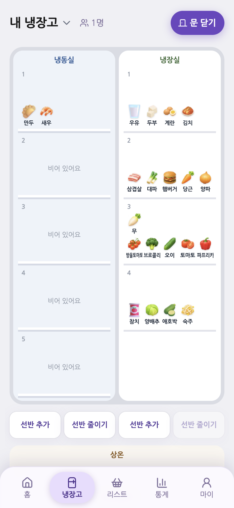
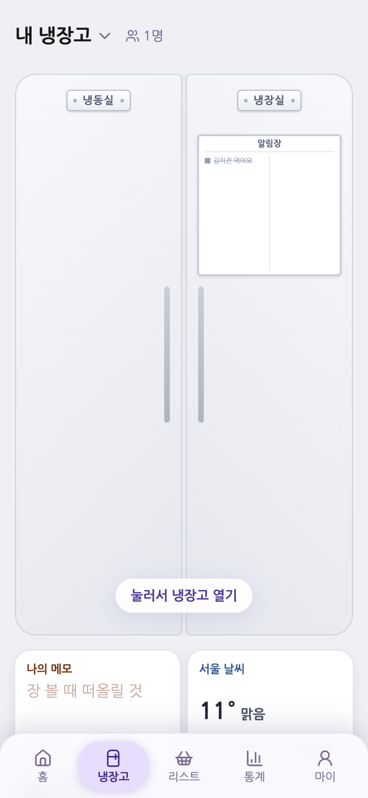
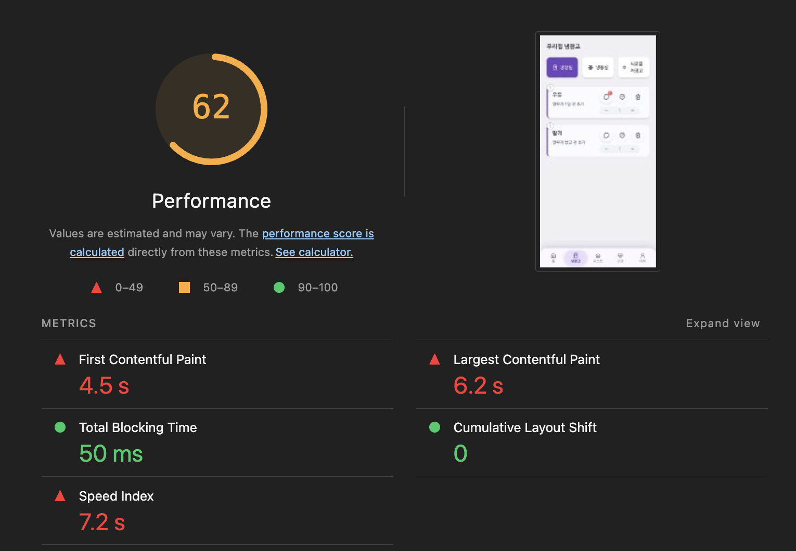
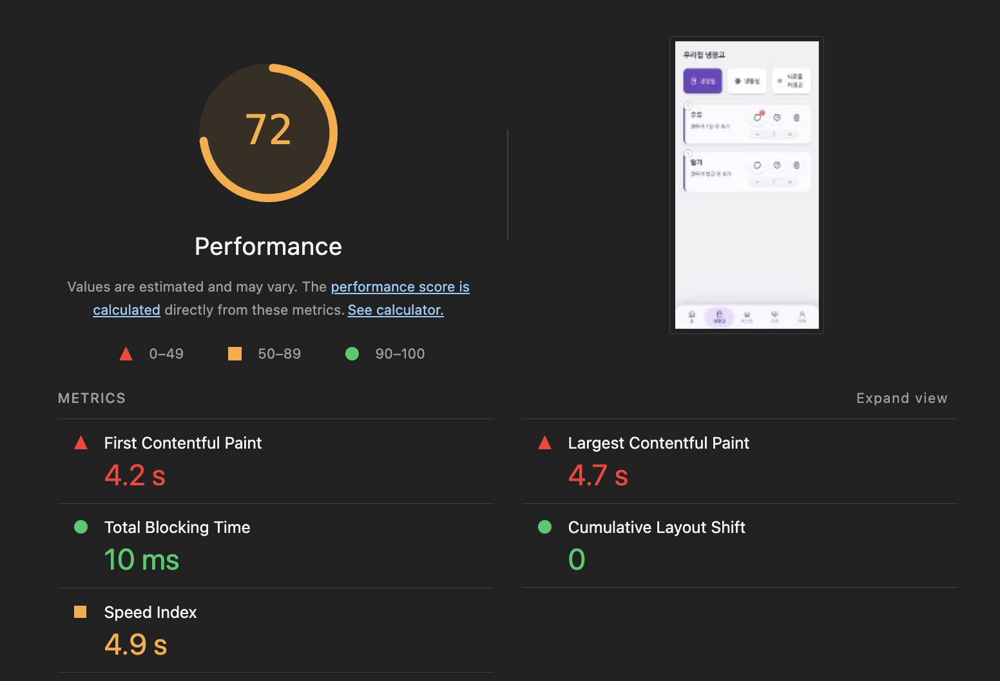

# 🥦 우리집 냉장고 (Greenbox)

<div align="center">

<!-- 최신 운영 화면 (테스트 계정, 2026-11-15 v1.12.13, 선반 보기 베타를 켠 냉장고). 파일은 docs/images/screens/ -->



**가족이 함께 쓰는 냉장고에 무엇이 어디에 얼마나 남았는지 보여 주는 PWA**

[서비스 열기](https://greenbox-seven.vercel.app) | [결정 기록](docs/decisions) | [최근 PR](https://github.com/hyunji1117/greenbox/pulls?q=is%3Apr+is%3Amerged)

</div>

## 1. 한눈에 보기

**누구의 어떤 문제:** 장 보는 사람과 꺼내 먹는 사람이 다른 가족은 냉장고에 무엇이 남았는지 몰라 같은 것을 또 사거나, 넣어 둔 것을 잊어 유통기한을 넘깁니다. Greenbox는 가족이 각자 계정으로 같은 냉장고를 보고, 곧 먹어야 할 것을 알림과 레시피로 알려 줍니다.

**운영 상태:** 2025.09 기기 저장 첫 버전에서 시작해 2026.10부터 서버 저장(Postgres), 가족 공유, 웹뷰 앱 셸로 리뉴얼했습니다. 기획, 개발, 운영은 혼자 맡고, 사용자는 우리 가족 3명과 지인 가족 2명입니다. 현재 운영 버전은 v1.12.13(2026-11-15)입니다.

**구현, 검증, 사용자 효과를 나눠 적습니다.** 아래 "지금 쓸 수 있는 것"은 운영에 배포된 기능이고, 사용자 효과를 확인한 것은 따로 표시합니다. 대부분은 아직 사용자 효과를 확인하지 않았습니다.

### 지금 쓸 수 있는 것 (서버 저장)

| 기능             | 지금 동작하는 범위                                                                                                                                                                     |
| ---------------- | -------------------------------------------------------------------------------------------------------------------------------------------------------------------------------------- |
| 로그인과 동의    | 구글 로그인, 필수 항목 동의 기록, 개인정보처리방침 버전별 재동의와 변경 안내                                                                                                           |
| 냉장고 품목      | 직접, 사진(식재료 인식), 음성으로 등록. 수량(마트 단위와 g), 권장 보관 기간으로 채우는 유통기한, 먹음/버림과 되돌리기, 댓글                                                            |
| 가족 공유        | 초대 링크, 참여 요청과 승인, 각자 계정으로 같은 냉장고 보기 ([#52](https://github.com/hyunji1117/greenbox/pull/52))                                                                    |
| 첫 화면          | 서버에서 품목을 조회해 HTML을 스트리밍하고, TanStack Query 캐시를 넘겨 첫 로드 중복 요청을 없앰 ([#45](https://github.com/hyunji1117/greenbox/pull/45))                                |
| 알림             | Web Push. 사람마다 받을 시각과 주간 요약, 냉장고별 알림 수준, 관심 품목 ([#56](https://github.com/hyunji1117/greenbox/pull/56), [#65](https://github.com/hyunji1117/greenbox/pull/65)) |
| 레시피           | 곧 먹어야 할 재료가 있을 때 15분 레시피와 그림을 AI로 만들고(처음 쓸 때 동의), 빠진 재료는 장보기에 담음 ([ADR 0007](docs/decisions/0007-quick-recipes.md))                            |
| 선반 보기 (베타) | 기본 꺼짐. 설정에서 가족 누구나 켬. 양문형 냉장고, 선반마다 식재료 그림, 문 위 알림장 ([ADR 0012](docs/decisions/0012-shelf-view-beta.md))                                             |
| 웹뷰 앱 셸       | Expo 앱이 운영 웹을 열고, 구글 로그인은 시스템 브라우저에서 처리해 세션을 넘김. 스토어 제출과 앱 푸시는 미완료 ([ADR 0011](docs/decisions/0011-mobile-webview-shell.md))               |
| PWA              | 홈 화면 설치, Service Worker가 앱 셸과 정적 이미지를 미리 저장(오프라인에서 화면 틀이 열림)                                                                                            |

### 아직 기기에만 저장되는 것과 한계

- 장보기 리스트와 즐겨찾기는 `localStorage`, 구매 기록은 `IndexedDB`에 저장합니다. 다른 기기나 가족과 공유되지 않습니다.
- 오프라인에서는 화면 틀만 열립니다. 오프라인 중 서버 데이터 변경과 다시 연결됐을 때의 병합은 다루지 않았습니다.
- 선반 보기의 사용자 비교(목록보다 빨리 찾는지)는 아직 하지 않았습니다. 테스트 계정 점검까지 마쳤습니다.

### 현재 구조

```
[모바일 웹 / Expo WebView 앱 셸]
        │  첫 요청: HTML 스트리밍
        ▼
[Next.js 15 App Router / Node.js 런타임 / Vercel]
  ├─ 서버 컴포넌트: 세션과 품목 조회 → TanStack Query prefetch → HydrationBoundary로 캐시 전달
  ├─ Route Handler: API (zod 스키마를 서버/화면이 공유)
  └─ Web Push 발송
        ▼
[Postgres] 트랜잭션, 조건부 upsert, CHECK 제약, 추가형 마이그레이션 (db/migrations)
```

### 결정 기록과 PR

- 결정 기록(ADR): [`docs/decisions`](docs/decisions). 웹뷰 앱 셸([0011](docs/decisions/0011-mobile-webview-shell.md)), 선반 보기 베타와 단계 공개([0012](docs/decisions/0012-shelf-view-beta.md)), 초간단 레시피([0007](docs/decisions/0007-quick-recipes.md)), 실사용 성능과 오류 수집([0009](docs/decisions/0009-telemetry.md)), 알림 문구 A/B([0010](docs/decisions/0010-push-copy-ab.md))
- 첫 화면 Streaming SSR: 서버 스트리밍([#45](https://github.com/hyunji1117/greenbox/pull/45)), 글꼴 자체 제공([#46](https://github.com/hyunji1117/greenbox/pull/46)), 방침 배너 LCP 회귀 해소([#67](https://github.com/hyunji1117/greenbox/pull/67))
- 사용자 의견 반영: 등록, 찾기, 수량, 먹음 흐름([#71](https://github.com/hyunji1117/greenbox/pull/71)), 넣은 냉장고와 칸 안내([#81](https://github.com/hyunji1117/greenbox/pull/81))
- 웹뷰 앱 셸과 로그인 넘겨주기([#76](https://github.com/hyunji1117/greenbox/pull/76)), 운영에서 찾은 원인 수정([#77](https://github.com/hyunji1117/greenbox/pull/77), [#79](https://github.com/hyunji1117/greenbox/pull/79), [#80](https://github.com/hyunji1117/greenbox/pull/80))
- 선반 보기 베타([#83](https://github.com/hyunji1117/greenbox/pull/83)), 사용자 테스트 전 점검에서 찾은 문제 수정([#85](https://github.com/hyunji1117/greenbox/pull/85), [#88](https://github.com/hyunji1117/greenbox/pull/88), [#89](https://github.com/hyunji1117/greenbox/pull/89))
- 문 밀어 여닫기([#92](https://github.com/hyunji1117/greenbox/pull/92)), 의견 음성 자동 전송과 베타 스위치 변경 기록([#93](https://github.com/hyunji1117/greenbox/pull/93)), 가족 게시판([#94](https://github.com/hyunji1117/greenbox/pull/94)), 품목 단위와 g, 베타 모든 계정 공개([#95](https://github.com/hyunji1117/greenbox/pull/95)), 냉장실 문 알림장([#96](https://github.com/hyunji1117/greenbox/pull/96))

## 2. 판단 사례

### 저장 실패처럼 보인 반응을 위치 안내 문제로 좁히기 (2026.11.10, v1.10.0, [#81](https://github.com/hyunji1117/greenbox/pull/81))

- **관찰:** 가족 2명에게 식재료를 넣고 들어갔는지 확인하는 과제를 부탁했습니다. 1명은 넣은 새우가 보이지 않자 등록에 실패했다고 보고 다시 넣었습니다.
- **대조:** 운영 DB에는 새우가 냉동실에 저장돼 있었고, 같은 시간 화면 오류는 없었습니다. 품목 추가와 냉장고 칸 전환 기록도 함께 봤습니다.
- **판단:** 저장 실패가 아니라 다른 칸에 들어간 품목을 알아보지 못한 문제로 좁혔습니다.
- **선택:** 입력할 때 칸을 고르는 단계나 새 기능을 늘리지 않고, 완료 안내에 넣은 냉장고와 칸을 보여 주는 것부터 바꿨습니다. 사진으로 넣은 품목이 모두 다른 칸이면 그 칸으로 옮겨 보여 줍니다. 칸 고르기와 마지막 칸 기억은 미뤘습니다.
- **검증 범위:** 당시 전체 테스트 330개 통과, 운영 v1.10.0 배포. 같은 사용자가 바뀐 화면으로 다시 찾는지는 아직 확인하지 않았습니다.

### 선반 보기: 검증 기준을 먼저 정하고 아직 하지 않은 비교는 남기기 (2026.11.11~, [ADR 0012](docs/decisions/0012-shelf-view-beta.md))

- 가족 테스트에서 "냉장고 모양이면 어디 있는지 바로 알겠다"는 의견이 나와, 목록보다 도움 없이 같거나 짧은 시간에 찾는지를 가설로 두고 유지, 수정, 버리기 기준을 테스트 전에 적었습니다.
- 데이터 변경은 추가만 하고(0015), 냉장고별 스위치로 공개했습니다. 개발자 냉장고에서 켠 베타가 가족 5명에게 보인 것을 찾아 바로 끄고 1인 테스트 냉장고로 줄였습니다.
- 지금은 모든 계정 설정에 스위치를 보이게 했지만 기본은 꺼짐입니다(v1.12.12). **같은 사람이 두 화면을 쓰는 가족 비교는 아직 하지 않았고, 사용자 가설의 결과는 없습니다.**

### AI 점검 뒤 실패 경로를 직접 추적하고 회귀 테스트로 고정 (2026.11.14~15, [#85](https://github.com/hyunji1117/greenbox/pull/85), [#88](https://github.com/hyunji1117/greenbox/pull/88), [#89](https://github.com/hyunji1117/greenbox/pull/89))

- 가족 비교 전에 AI 에이전트에게 테스트 계정으로 21개 항목(기능 17, 계측 4)을 점검하게 하고, 실패마다 화면과 이벤트 기록을 남기게 했습니다. 원인 판단과 수정은 직접 했습니다.
- 가설을 재는 `item_shelf_set` 이벤트가 상세 시트에서는 기록되지만 목록 줄의 "선반 정하기"에서는 빠졌습니다. 선반을 고르는 순간 품목이 그 목록에서 빠지며 줄 컴포넌트가 사라져, 저장 성공 콜백이 불리지 않는 경로였습니다. `mutateAsync`가 끝난 뒤 기록하도록 바꾸고, 화면이 사라진 뒤에도 한 번 기록되는지와 저장 실패 시 보내지 않는지를 테스트로 고정했습니다.
- 다시 점검하며 두 줄 선반에서 그림이 선반 번호를 덮는 것(이름 칸이 기본 줄 높이를 물려받은 것이 원인)과 작은 화면에서 안내가 하단 메뉴에 가리는 것을 찾아 고쳤고, 3건 모두 운영에서 다시 확인했습니다(v1.12.2~v1.12.6).

## 3. 성능: 두 단계의 서로 다른 측정

두 단계는 측정 시점, 조건, 지표가 달라 숫자를 이어 붙이지 않습니다. 모두 측정 환경의 값이고, 실사용자 효과로 바꿔 쓰지 않습니다.

### 3-1. (2026.06) 첫 로드에서 차트 라이브러리 분리

마트에서 장을 보며 쓰는 앱이라 약한 네트워크를 기본으로 봤습니다. Lighthouse(모바일 / Slow 4G) 베이스라인에서 병목은 첫 화면이 뜨는 속도(LCP 6.2s)였고, 번들을 분석하니 분석 탭 한 곳에서만 쓰는 recharts(약 343KB)가 모든 사용자의 첫 로드에 들어 있었습니다. `next/dynamic`으로 그 탭을 열 때만 불러오도록 나눴습니다.

| 지표                     | Before | After      | 변화     |
| ------------------------ | ------ | ---------- | -------- |
| `/` First Load JS        | 240 kB | **117 kB** | **−51%** |
| Performance              | 62     | **72**     | +10      |
| Largest Contentful Paint | 6.2s   | **4.7s**   | −24%     |
| Speed Index              | 7.2s   | **4.9s**   | −32%     |
| Total Blocking Time      | 50ms   | **10ms**   | −80%     |

<div align="center">
<table>
<tr>
<td align="center"><b>Before</b><br/>Performance 62</td>
<td align="center"><b>After</b><br/>Performance 72</td>
</tr>
<tr>
<td></td>
<td></td>
</tr>
</table>
</div>

이후 2026.11.05 탭 개편으로 분석 탭을 통계 탭으로 바꾸면서 recharts는 걷어냈습니다([#53](https://github.com/hyunji1117/greenbox/pull/53)).

### 3-2. (2026.11) 첫 데이터 표시를 주 지표로 한 Streaming SSR

리뉴얼 뒤 첫 화면은 빈 로딩 화면 뒤에 JS 실행과 API 조회가 이어졌습니다. LCP 요소가 곧 사라지는 로딩 화면이어서, 실제 품목이 보이는 순간(첫 데이터 표시)을 주 지표로 정했습니다. 서버에서 품목을 조회해 HTML을 스트리밍하고 TanStack Query 캐시를 넘겼으며([#45](https://github.com/hyunji1117/greenbox/pull/45)), 이후 드러난 글꼴 병목은 `next/font` 자체 제공으로 풀었습니다([#46](https://github.com/hyunji1117/greenbox/pull/46)).

| 지표           | Before  | After       | 측정 조건                                |
| -------------- | ------- | ----------- | ---------------------------------------- |
| 첫 데이터 표시 | 5,066ms | **2,075ms** | CPU 4x, Slow 4G, 5회 중앙값              |
| LCP            | 3,619ms | **2,120ms** | Lighthouse 모바일 시뮬레이션, 5회 중앙값 |

같은 조건으로 다시 재다가 방침 변경 배너가 늦게 그려지며 생긴 LCP 회귀를 찾아, 배너를 첫 HTML에 함께 그리도록 고쳤습니다([#67](https://github.com/hyunji1117/greenbox/pull/67)).

## 4. 서버 상태 설계: React Query + zod (2026.10 전환 당시)

> 냉장고 품목이 화면 메모리 목업에만 있어 새로고침하면 사라졌고, 서버 응답도 `as` 단언으로만 믿고 있었습니다. 품목을 Postgres API로 옮기면서 서버 상태 레이어를 설계했습니다([#37](https://github.com/hyunji1117/greenbox/pull/37)).

### 설계 결정

| 결정                                                                          | 이유                                                                                                |
| ----------------------------------------------------------------------------- | --------------------------------------------------------------------------------------------------- |
| 요청/응답 zod 스키마를 한 파일에 모아 서버 요청과 클라이언트 응답을 각각 검증 | API 계약을 한곳에 두고, 타입이 사라지는 런타임에서 불일치를 네트워크 경계에서 잡기 위해             |
| `apiFetch(url, schema)`로 호출 창구 통일                                      | 재시도할 수 있는 실패(5xx, 네트워크)와 다시 보내도 같은 실패(4xx, 응답 형식 불일치)를 구분하기 위해 |
| 계층형 쿼리 키 `itemKeys`                                                     | 무효화 범위를 키 하나로 표현하고, 키 오타를 막기 위해                                               |
| 수량 변경과 소진에 낙관적 업데이트                                            | 약한 네트워크(마트)에서도 바로 반응해야 하고, 결과를 미리 알 수 있는 변경이라서                     |
| 등록은 성공 후 무효화, 댓글은 응답을 캐시에 반영                              | 서버가 id를 만드는 변경이라 결과를 미리 알 수 없어서                                                |
| (당시) 첫 화면은 정적으로 유지하고 클라이언트에서 조회                        | 로그인 뒤 사용자별 데이터라서. 이후 첫 데이터 표시가 늦어 Streaming SSR로 전환 (3-2, #45)           |

### 낙관적 업데이트에서 막은 경쟁 상태

1. **진행 중인 조회가 낙관적 값을 덮어씀** → `onMutate`에서 `cancelQueries`
2. **실패 롤백이 다른 품목의 변경까지 되돌림** → 목록 스냅샷이 아니라 실패한 품목만 복원
3. **먼저 끝난 요청의 재조회가 진행 중인 변경을 덮어씀** → 마지막 변경이 끝날 때만 무효화 (`isMutating`)
4. **같은 품목 연속 변경의 응답 순서 역전** → mutation `scope`로 품목별 직렬화

### 전환 당시 결과

| 지표                  | Before           | After               |
| --------------------- | ---------------- | ------------------- |
| 새로고침 후 품목 유지 | 사라짐           | **유지** (Postgres) |
| `FridgeContext.tsx`   | 320줄            | **152줄**           |
| 응답 런타임 검증      | 없음 (`as` 단언) | **zod 스키마**      |
| 단위 테스트           | 0개              | **75개** (Vitest)   |

같은 개발 환경(StrictMode)의 첫 화면에서 직접 `fetch`하는 `/api/me`는 2회, React Query를 쓰는 `/api/items`는 1회 요청합니다. 운영 빌드에서는 StrictMode의 이중 실행이 없어 직접 `fetch`도 1회이므로, 이 수치는 운영 성능 개선이 아니라 중복 제거 동작의 확인입니다.

전환 당시에는 가족 기능 전이라 품목을 사용자(`user_id`) 기준으로 저장했고, 이후 냉장고 단위 공유로 확장했습니다(`db/migrations/0007_fridges.sql`, [#52](https://github.com/hyunji1117/greenbox/pull/52)). 2026-11-15 기준 전체 테스트는 Vitest 90개 파일, 392개가 통과합니다.

## 5. 기술 스택

### Frontend

- **Framework**: Next.js 15 (App Router), React 19, TypeScript
- **Styling**: Tailwind CSS
- **Server State**: TanStack Query (React Query), zod
- **Test**: Vitest, Testing Library

### Backend

- **API**: Next.js Route Handlers (Node.js 런타임)
- **DB**: PostgreSQL (`pg`), `db/migrations`의 추가형 SQL 마이그레이션
- **Auth**: Auth.js (Google)
- **AI**: Anthropic(사진 속 식재료 찾기, 레시피 글), OpenAI(레시피 그림)

### App, PWA & Local Data

- **앱 셸**: Expo, React Native WebView (`mobile/`)
- **PWA**: `@ducanh2912/next-pwa` (Workbox 기반 Service Worker)
- **로컬 저장소**: localStorage (장보기 리스트, 즐겨찾기), IndexedDB (구매 기록)
- **푸시**: Web Push API, web-push, VAPID, 매시간 예약 호출

## 6. 시작하기

### 요구사항

- Node.js 20 이상
- npm

### 설치 및 실행

```bash
# 레포지토리 클론
git clone https://github.com/hyunji1117/greenbox.git
cd greenbox

# 의존성 설치
npm install

# 개발 서버 실행
npm run dev

# 단위 테스트
npm test
```

개발 서버가 실행되면 [http://localhost:8809](http://localhost:8809)에서 확인할 수 있습니다.

### 환경 변수 (로그인과 DB)

```env
DATABASE_URL=your_database_url
DATABASE_CA_CERT=your_ca_certificate
AUTH_SECRET=your_auth_secret
AUTH_GOOGLE_ID=your_google_client_id
AUTH_GOOGLE_SECRET=your_google_client_secret
```

DB 스키마는 `db/migrations`의 SQL을 번호 순서대로 적용합니다.

로컬에서는 운영 DB 대신 이 컴퓨터 안의 개발용 PostgreSQL을 씁니다. `scripts/dev-db.sh setup`으로 한 번 만들고(홈 폴더 `~/.greenbox-dev-db`, 마이그레이션 자동 적용), `scripts/dev-db.sh dev`로 그 DB를 보는 개발 서버를 띄웁니다. 인증서와 비밀번호는 컴퓨터마다 새로 만들어 저장소에 넣지 않습니다.

### 환경 변수 (웹 푸시 알림용)

```env
# Web Push (VAPID)
CRON_SECRET=your_random_secret_for_cron
NEXT_PUBLIC_VAPID_PUBLIC_KEY=your_vapid_public_key
VAPID_PUBLIC_KEY=your_vapid_public_key
VAPID_PRIVATE_KEY=your_vapid_private_key
VAPID_SUBJECT=mailto:your_email@example.com
```

## 앞으로의 과제

아직 하지 않은 일입니다.

- **선반 보기 가족 비교** - 같은 사람이 목록과 선반 보기를 모두 써 보는 비교로 가설을 판단하고, 결과를 유지/수정/버리기 기준대로 기록합니다.
- **나머지 데이터의 서버 연동** - 장보기 리스트와 구매 기록은 아직 기기에만 저장됩니다.
- **오프라인에서 변경한 데이터의 동기화** - 오프라인에서는 화면 틀만 열립니다. 오프라인 중 변경을 다시 연결됐을 때 안전하게 병합하는 부분은 다루지 못했습니다. 실시간 협업과 CRDT 같은 접근을 학습하며(오픈소스 yorkie에 기여한 경험이 있습니다) 이어서 고민하고 있습니다.
- **앱 스토어 제출과 앱 푸시** - 웹뷰 앱 셸은 구현했지만 스토어 제출과 앱 자체 푸시는 하지 않았습니다.

## 라이선스

이 프로젝트는 MIT 라이선스 하에 배포됩니다.

선반 보기의 식재료 그림(`public/foods/`)은 대부분 이 프로젝트에서 직접 만든 그림입니다(채소, 고기, 해산물, 장과 양념, 한국 음식, 외국 식재료, 세계 음식). 직접 만든 그림이 없는 과일 등 일부는 [Microsoft Fluent Emoji](https://github.com/microsoft/fluentui-emoji)(MIT, Copyright (c) Microsoft Corporation)의 3D 그림을 96px로 줄여 사용하며, 원문 라이선스는 `public/foods/LICENSE`에 있습니다. 어느 이름이 어느 그림인지는 `app/lib/shelves/foodIcons.ts`에 있습니다.

## 연락처

**김현지**

- GitHub: [@hyunji1117](https://github.com/hyunji1117)

---

<div align="center">

Made with 🥦 by Greenbox

</div>
